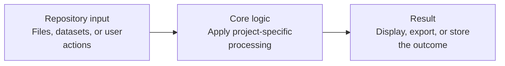

# My Projects

**Learning archive** · A mixed learning and small-project archive spanning web, Python, React, and automation examples.

## Overview

A mixed learning and small-project archive spanning web, Python, React, and automation examples.

## Technology Stack

- `Node.js`
- `React`
- `HTML`
- `CSS`
- `JavaScript`
- `Python`

## How the Repository Works

| Stage | Responsibility |
|---|---|
| **Repository input** | Files, datasets, or user actions |
| **Core logic** | Apply project-specific processing |
| **Result** | Display, export, or store the outcome |

## Concepts Covered

- Component-based UI
- State and props
- Event handling
- Reusable layout
- Client-side rendering

## Repository Map

- `.gitattributes`
- `.gitignore`
- `automatic unfollow instagram`
- `Car DealerShip Website`
- `Catch Me`
- `Python Project`
- `React projects`

## Recruiter Summary

This repository shows hands-on practice, iterative learning, and problem-solving across the technologies listed above. It is most useful as evidence of foundational growth and experimentation rather than as a production release.

---

Documentation is concise and project-focused; source code was not modified.
